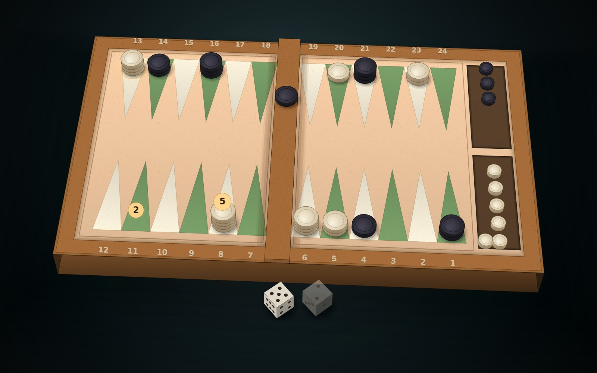

# Backgammon — 3D

A complete backgammon game that runs in the browser. No dependencies, no build
step: plain ES modules, a hand-rolled 3D projection and the Canvas 2D API.

The board is a solid slab in perspective: every face is flat-shaded from one
light direction, the timber has a chamfered edge and the play field sits
recessed inside it. Nothing is glossy — the surfaces are matte, and a fine grain
is laid over every colour so the board, the points and the checkers all read as
material rather than flat vector fills. Checkers are real cylinders with side
walls and contact shadows, and the dice are **actual cubes** whose pips sit on
the faces — they tumble through quaternion-space while rolling and land on the
number you rolled.

The layout follows the reference diagram: two framed panels side by side on a
pale peach field, the outer boards on the left and each player's home board on
the right, short sage-and-cream points that stop well short of the centre, and
a raised **vertical bar** standing in the channel between the panels. The board
is divided **left to right only** — no line runs across it horizontally, so the
bar is the single section in the surface.



## Play

```bash
npm start          # http://localhost:8080
```

Any static server works too (`python3 -m http.server`), the modules just need to
be served over http. The bundled server only ever serves project files: `.git`,
dotfiles and `node_modules` are refused, and paths that try to climb out of the
project directory are clamped, so it is safe to expose on a preview URL.

## What you can do

- **Roll the dice** — press `Space`, click **Roll dice**, or click the board.
- **Move the pieces** — click a checker, then click one of the highlighted
  points (the gold badges show which die is used). Click the tray to bear off.
- Play **against the computer** (default) or **two players** on one screen.
- **New game** — the **New game** button, `N`, or *New game* on the win overlay.
  Every new game **draws a side at random**: you get White or Black with a 50/50
  chance and the computer takes the other. The draw is announced in the toast,
  tagged `you` on your pip row, and shown in the turn chip; when you draw Black
  the computer opens for White, so you can never roll out of turn.
- **Undo** your moves during your own turn, hit `Esc` to deselect. Sound can be
  muted with the ♪ button.

## The run (a tiny roguelike)

Every checker **you** move banks points, and they go into a stake you are trying
to clear before the computer wins the game.

- **Base: 20 points** for any move.
- **Speed bonus or penalty:** the move is scored on how much race it takes off
  your clock. Race is measured at the classic 8.5 pips per roll, plus two and a
  half rolls for every checker still on the bar. A move that gains six pips
  scores about +10; one that gains one pip scores about +2; giving ground costs.
- **Tactics:** hitting a blot +12, making a point +9, bearing off +8, coming in
  from the bar +5, and −7 for every blot you leave.

The stake is 500 points at stake I, then 1000, 1600, 2400, 3400, 4600, and keeps
climbing. Clear one and the next is bigger; winning pays a bonus on top (150 for
a single, 300 for a gammon, 450 for a backgammon). Lose a game before the stake
is clear and the run drops back to stake I. Each move's points float up over the
board, and the chip in the corner shows `score / stake` with a progress bar.

### The shop

Clear a stake and you are paid coins (45, plus 10 for a clear inside 20 moves)
and a small shop opens — **for now only after stake I**. Spend coins on:

- **Loaded dice** (30) — reroll your dice once a game, before you move. The
  `Reroll · n` button appears in the roll panel; `R` does the same.
- **Lucky charm** (40) — +6 points on every move for the rest of the run.
- **Head start** (55) — every new game opens with 120 points already banked.

Every item stacks. What you cannot buy is another checker: backgammon is 15 a
side, and the pips, the bear-off and the win detection all assume it — a 16th
checker would break the game rather than upgrade it.

The shop freezes the table: no rolls, no clicks, no computer moves until you
press **Continue**. Coins, perks and the wallet survive the run; losing sends
you back to stake I but keeps your purchases.

## Rules implemented

- Standard starting position (167 pips), direction of play, no two-sided points.
- Blots are hit and sent to the bar; a player on the bar must re-enter into the
  opponent's home board before doing anything else.
- Bearing off only when all fifteen checkers are home; an oversized die may only
  be used on the checker farthest from the goal.
- Doubles are played four times.
- You must use as many dice as possible — if only one die can be played, the
  higher one must be played. Illegal moves simply never appear as options.
- Turns end automatically when no legal move is left; gammons and backgammons
  are detected when the game ends.

## The computer opponent

`js/ai.js` enumerates every legal turn with a depth-first search (deduplicated
and capped, typically a few milliseconds) and scores the resulting positions on
pip count, blots and exposure, points made, checkers on the bar and checkers
borne off. It plays a solid game and never makes an illegal move.

## Layout of the code

| file | role |
| --- | --- |
| `index.html`, `styles.css` | page shell, HUD, glass panels |
| `js/rules.js` | position, legal moves, hits, bear-off, turn-optimality search |
| `js/ai.js` | computer opponent (full-turn search + heuristic) |
| `js/scene.js` | perspective camera, board geometry, 3D checkers and dice |
| `js/score.js` | the run: per-move scoring, stakes, win bonuses (pure) |
| `js/shop.js` | the shop: items, prices, purchases, coin payout (pure) |
| `js/app.js` | game flow, input, animation, UI, synthesised sound |
| `server.js` | tiny dependency-free static server |

The camera is a real pinhole model: world → screen happens in `Camera.project()`
and screen → board plane in `Camera.unproject()`, which is what makes clicking
perspective-correct points possible. `Camera.fit()` picks the elevation, focal
length and offset so the whole board always fits the viewport.

## Tests

```bash
npm test
```

- `test/rules.test.js` — rule checks plus 300 complete random games that assert
  the invariants (checker counts, no negative stacks, games terminate).
- `test/ai.test.js` — the AI's moves are always legal, it finds hits, it answers
  in a few milliseconds, and it plays 40 full games against itself.
- `test/score.test.js` — the run's maths: the 20-point base, speed bonus vs
  penalty, hit/point/off/blot values, the rating dropping as you close the race,
  and the stake escalation.
- `test/app.test.js` — boots the real app against a mock DOM/canvas, rolls,
  clicks projected board positions and moves checkers, so the renderer and game
  flow are exercised end to end in Node — including banking points, clearing a
  stake and the computer earning you nothing.
- `test/shop.test.js` — the catalogue, prices, purchases, coin payout, and that
  nothing in the shop changes the number of checkers.
- `test/app.test.js` — the shop opens when stake I clears, freezes the table,
  sells perks that then show up in the score and the dice.
- `test/server.test.js` — the static server serves the app and nothing else.
